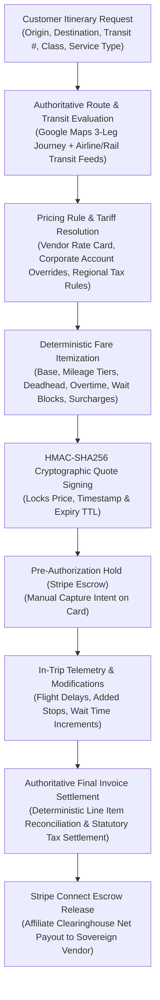

# Global Hub & Sovereign Vendor Black-Car Pricing Architecture

## 1. System Overview
The Black-Car Pricing Engine provides authoritative, deterministic, multi-tenant pricing for global multi-modal ground transportation. Operating across sovereign vendor cells and the centralized marketplace clearinghouse, the engine enforces strict separation between:
1. **Customer Selling Price**: Authoritative passenger gross charges.
2. **Supplier Compensation / Net Cost**: Contracted vendor compensation based on rate cards or net markup/margin policies.
3. **Platform Clearinghouse Margin**: Network facilitation fee (default 80/10/10 or custom commission splits).
4. **Driver Gratuity**: Separately allocated, non-commissionable chauffeur tips.
5. **Reimbursable Expenses**: Exact pass-throughs for bridge/tunnel tolls, airport staging fees, and municipality congestion levies.
6. **Statutory Tax Liabilities**: Strict regional VAT, GST, and sales tax itemization.

---

## 2. End-to-End Pipeline & Life Cycle

### Detailed Lifecycle Phases:
1. **Quote Calculation (`calculate_quote` / `calculate_quote_matrix`)**:
   - Calculates road distance, duration, and deadhead staging buffers using Google Maps Matrix.
   - Evaluates active vendor rate card or negotiated corporate account rates.
   - Applies progressive mileage bands, hourly minimums, waiting increments, and stacking policies.
   - Signs the quote payload with server-side HMAC-SHA256 secret (`PRICING_SIGNATURE_SECRET`).
2. **Quote Acceptance & Locking**:
   - Quote persists to MySQL / authoritative storage with 2-hour TTL.
   - Cryptographic signature verified upon checkout initialization (`verify_quote_integrity`).
3. **Payment Pre-Authorization**:
   - Stripe PaymentIntent created with `capture_method='manual'` (escrow holding mode).
4. **In-Flight & In-Trip Adjustments**:
   - Flight status webhooks adjust pickup times dynamically without unauthorized penalty fees.
   - Customer-requested waiting and stops recorded with timestamped GPS evidence.
5. **Final Settlement & Vendor Payout**:
   - Reconciles captured funds against verified trip metrics.
   - Dispatches net vendor payout via Stripe Connect transfers.

---

## 3. Core Domain Entities & Schemas
- **`VendorPricingRule`**:
  - `pricing_model_type`: `DYNAMIC_MATRIX`, `FLAT_ALL_INCLUSIVE_PER_MILE`, `FLAT_HOURLY_CHARTER`.
  - `tax_gratuity_display_mode`: `ITEMIZED_SEPARATE` vs `ALL_INCLUSIVE_BUNDLED`.
  - `progressive_distance_tiers`: Tiered rate bands (e.g., 0-10 mi @ $4/mi, 10-25 mi @ $3/mi).
  - `hourly_overtime_block_minutes`: Fractional charter extension intervals (default 15m).
  - `wait_block_minutes` & `wait_block_rate_net`: Granular block billing (e.g. $10 per started 5m).
  - `surcharge_stacking_mode`: `ADDITIVE` vs `HIGHEST_ONLY`.
  - `supplier_cost_net`, `supplier_cost_markup_pct`, `target_gross_margin_pct`.
- **`CorporateAccount`**:
  - `contracted_discount_pct`: Pre-tax negotiated enterprise discount.
  - `negotiated_route_rates`: Fixed city-pair and corridor rate overrides.
- **`Quote`**:
  - `signature_hash`: 64-character HMAC-SHA256 tamper-evident digest.
  - `line_items`: Itemized, self-reconciling charges.
  - `supplier_cost_net` & `gross_margin_pct`: Commercial accounting segregation.

---

## 4. Arithmetic & Precision Standards
- **Zero IEEE-754 Floating-Point Drift**: All currency arithmetic is strictly executed in `Decimal` with `ROUND_HALF_UP` bankers' rounding to 2 decimal places (cents) or currency minor units.
- **Line Item Summation Invariant**: `sum(item.total_net) == quote.subtotal_net` is guaranteed at all times.
- **Pre-Tax Discounting**: Corporate and promotional discounts are deducted from the eligible transportation subtotal prior to sales tax / VAT calculation.
